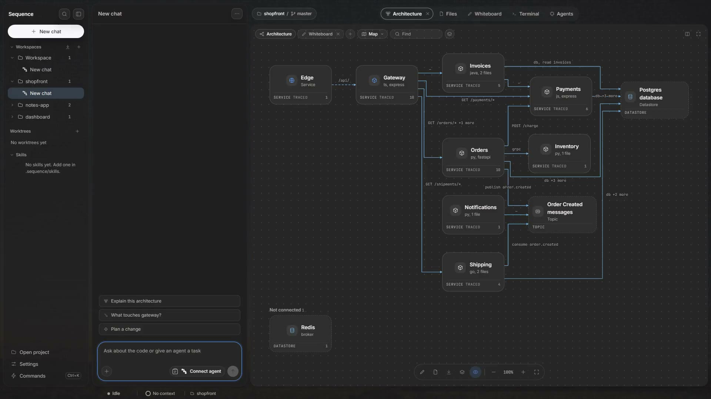
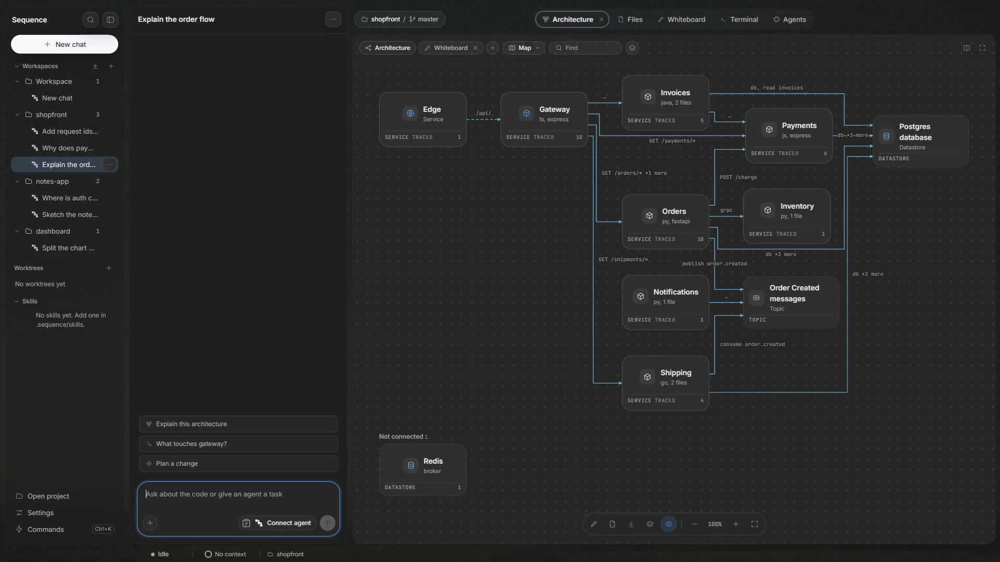
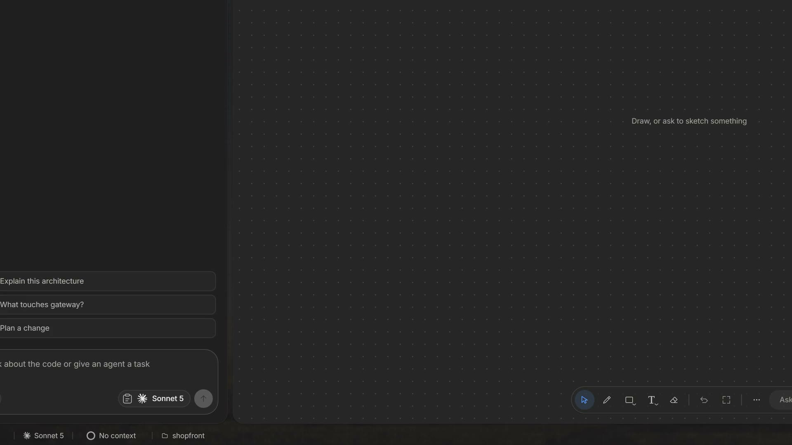
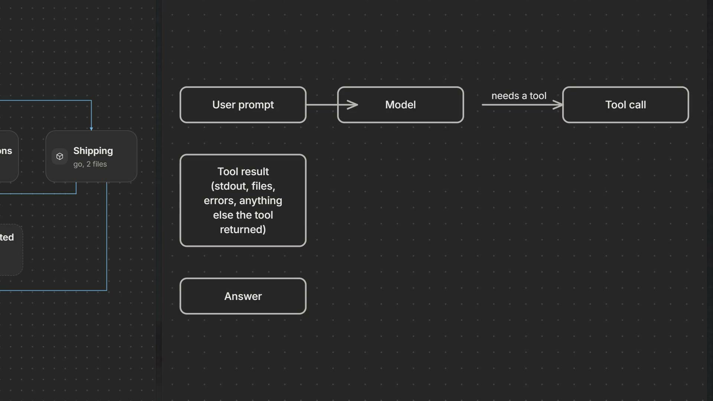
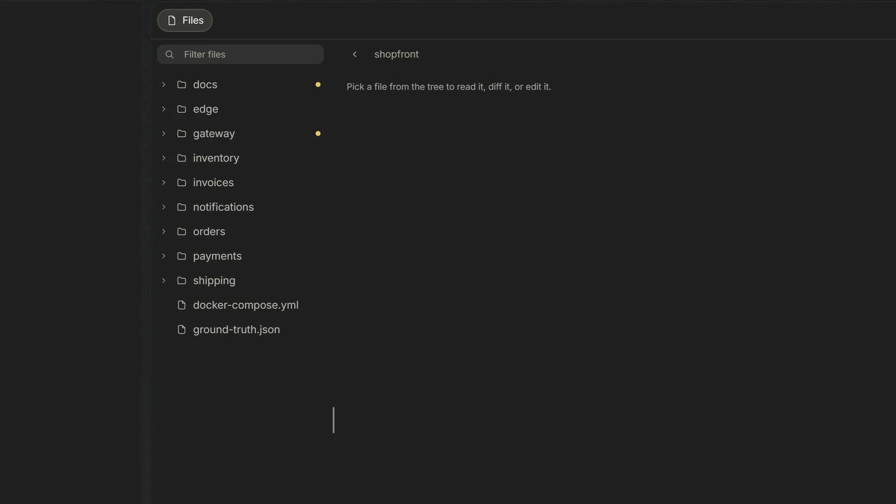
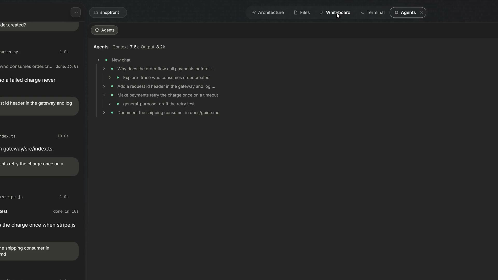
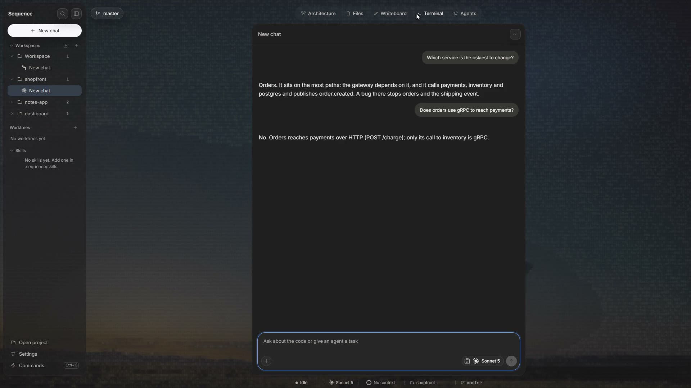

# Sequence

**A local app that maps a repository's architecture from its code, with a chat that answers from that map.**

It reads a repository into a live architecture graph with static analysis — no model involved —
and puts that graph beside a chat that answers from it. Every solid edge on the board traces to
a real import, call, route or manifest line. Anything drawn or proposed stays dashed until the
scanner finds it in code. The whole thing runs on your machine. Your code leaves it only for a
model or agent you connect: an API key, a local server, or a Claude Code or Codex sign-in. Without
one, the only network calls are a daily update check to GitHub (turn it off with
the `updates.check` setting (a Settings switch is coming in the UX update) or `SEQUENCE_NO_UPDATE_CHECK=1`; either stops every automatic request, and only Check now still asks) and, the first time Claude is used,
the bridge download from npm.

<p align="center">
  <a href="site/public/demo/v014/tour.mp4"></a>
</p>

## What's new in 0.1.8

- Components: 38 ready-made skills ship in the app and load at run time as tools, not by default. Three modes (auto, approval cards, off), `/components` and the + next to the chat box.
- Spaces replaces the whiteboard, and agents can draw with colours, lines, frames, SVG, scenes and video.
- Free web search and fetch for Claude, Codex and Sequence's own model, with no key.
- Mac: partial updates (the first update after a dmg install downloads the full zip once), and Cmd+C and Cmd+V work.
- Switching branches rescans the architecture board; files show status for the current branch.
- `/goal` on Claude and Codex, and a coverage line under agent answers.

The full list is in [docs/releases/v0.1.8.md](docs/releases/v0.1.8.md).

## A tour (clips recorded on 0.1.4)

<table>
  <tr>
    <td width="50%"><a href="site/public/demo/v014/workspaces.mp4"></a><br /><b>Workspaces.</b> Chats sit under each workspace, and New chat starts in the open one.</td>
    <td width="50%"><a href="site/public/demo/v014/whiteboard-draw.mp4"></a><br /><b>Whiteboard.</b> Ask for a diagram in chat. It lays itself out and animates in.</td>
  </tr>
  <tr>
    <td width="50%"><a href="site/public/demo/v014/ask-in-place.mp4"></a><br /><b>Ask in place.</b> Point at a box on the whiteboard or the map and ask. The chat gets that exact reference with a snapshot.</td>
    <td width="50%"><a href="site/public/demo/v014/files.mp4"></a><br /><b>Files.</b> A one-line breadcrumb, VS Code status colours, rendered Markdown and diagrams.</td>
  </tr>
  <tr>
    <td width="50%"><a href="site/public/demo/v014/agents-workflows.mp4"></a><br /><b>Agents.</b> Context and Output as the agent reports them. Workflows and runs stay collapsed until you open them.</td>
    <td width="50%"><a href="site/public/demo/v014/rewind.mp4"></a><br /><b>Edit from here.</b> Take a message and everything after it out of the chat. Undo until the next send.</td>
  </tr>
</table>

Each picture links to its clip. The clips use a sample shop repository; the app and scan are real, model answers are scripted replies. The run history and token figures in the Agents clip are illustrative.

Also in 0.1.4: a reasoning slider, a one-line terminal prompt, drawings and chart cards inline in chat,
Claude setting itself up the first time it is used, restart and continue, importing old Claude Code
and Codex chats, several agents at once with compare and merge, and opening a pull request from a
worktree chat.

## Download

The current version is 0.1.8. Installers are on the
[v0.1.8 release page](https://github.com/naidx0/sequence-arch-tool/releases/tag/v0.1.8). Free, no account.

- **Windows**: `Sequence Setup 0.1.8.exe` (installer) or `Sequence-0.1.8-win.zip` (portable).
- **macOS**: Apple silicon (`-arm64.dmg` / `-arm64-mac.zip`). Intel builds are on the release page but are not tested on every release.
- **Linux**: an AppImage or a deb.

`SHASUMS256.txt` on the same page lists the SHA-256 of every file.

**The installers are not code-signed or notarized.** There is no Apple Developer certificate and no
Windows code-signing identity behind this project yet, so the operating system warns the first time.

- **macOS 14 and earlier**: right-click the app and choose **Open**.
- **macOS 15 and later**: right-click Open no longer works. Open the app once, then go to
  **System Settings → Privacy & Security → Open Anyway**.
- **Windows**: SmartScreen shows **More info → Run anyway**.

If you would rather not click through a warning, clone and run from source; it is the same
program.

## Run from source

```bash
git clone https://github.com/naidx0/sequence-arch-tool sequence
cd sequence
./start.sh            # macOS / Linux
```

```powershell
.\start.ps1           # Windows — start.sh does not run on Windows; it opens in your editor
```

Either launcher installs dependencies, builds, and opens the app in your browser. Prerequisites:
**Node.js 20 or newer** and `pnpm` (the launchers enable it through `corepack` if it is missing).
Pass a repository path to attach it on start: `./start.sh /path/to/project` or
`.\start.ps1 C:\path\to\project`. Without one, Sequence opens its home workspace and you attach a
folder from the rail.

The raw equivalent, with no shell script: `pnpm install && pnpm build && pnpm start`
(`pnpm start -- --repo <dir>`, `--port <n>` and `--no-open` pass through).

## What is in the window

Chat stays on the left. The other panes open beside it and snap to clean splits.

| Pane | What it does |
|---|---|
| **Chat** | Asks are answered from the scanned graph with tools; every tool call is a card, every answer from Sequence's own model cites file and line or says what was not read, and a Claude or Codex answer carries a coverage line naming the services it opened files in. A model chip names the model, a ring shows how much of the context window the last turn used. `/goal <text>` starts a long-running run that writes a plan and works it one step per turn; it runs on Sequence's own model, or on the chat's Claude Code or Codex agent, in an open project: Sequence gives the agent a tool to tick each step, and a run whose plan does not move for three turns stops and says so. |
| **Architecture** | The scanned graph: packages, services, datastores and the typed edges between them. Solid edges were found in code; dashed ones are claims. Click a node and it becomes a chip in the composer. |
| **Files** | The tree and its symbols, beside the graph, with a one-line breadcrumb, status colours, and rendered Markdown and diagrams. |
| **Whiteboard** | Freehand ink beside the graph. A rough box, ellipse, diamond or arrow can be tidied into a clean shape by a small trained model (`@sequence/ink`); nothing drawn here is a claim about your code. (On the Architecture board, Sketch turns a box into a node and a line into an edge.) |
| **AI Canvas** | Where explanations land as blocks: Markdown, a Mermaid diagram, SVG, HTML or a React component, rendered on a plane you can draw on. What you draw there reaches the model on the next turn. |
| **Agents** | Context and Output as the agent reports them; workflows and runs collapsed until opened. |
| **Terminal** | A shell inside the harness, with a one-line prompt and a toolbar. |
| **Browser** | A page inside the harness, for checking what you just changed. |

## No key required

The scan, the board, the whiteboard, impact, risks and export are static analysis and run with
no account and no network. To chat, connect Claude Code or Codex (they
run on your own signed-in CLI, including a subscription), a local model (Ollama, LM Studio,
llama.cpp), or an API key (Settings): Anthropic, OpenAI, OpenRouter, or any OpenAI-compatible
endpoint. A key adds Sequence's own chat and canvas. Everything binds to `127.0.0.1`.

## What is measured, and what is not

- **The field report.** Answer quality, speed, memory, large codebases, drawing and downloads, each
  against a sealed baseline, with charts: [report/](report/README.md).
- **Importers by depth from one lookup.** For `packages/analyzer/src/scan.ts` on this repository
  (2026-09-18): 97 direct importers, 167 by depth 2, 194 by depth 3, 224 by depth 4, in one
  call. A grep needs 195 lookups before it can finish depth 4. Re-run it yourself:
  `python tools/measure/importers-by-depth.py`.
- **Not claimed: fewer tokens than grep on a one-hop lookup.** Measured, it is not true. The
  saving is round trips at depth, not tokens on the shallow case.

## CLI

The app shell is `sequence` (or `sequence app`). The scanner is also a standalone CLI
(`node packages/analyzer/dist/cli.js <cmd>`, or `pnpm exec sequence <cmd>` once built):

| Command | What it does |
|---|---|
| `scan <repo> [--out <file>] [--no-cluster]` | Infer the graph from a repository, static analysis only. |
| `explain <repo> [--out <file>]` | Print the structural outline in plain English, no key needed. |
| `score <graph.json> <ground-truth.json>` | Precision and recall against a hand-built ground truth. |
| `diff <base.json> <head.json> [--markdown <out>]` | Compare two graphs at the service level; exit 3 on any change. |
| `validate <spec.json>` | Structural and mode-aware checks: cycles, evidence rules, kind-constrained targets. |
| `export <graph.json> --format <fmt> [--out <file>]` | `mermaid-seq`, `mermaid-flow`, `matrix-md`, `matrix-csv` or `arch-md`. |
| `serve [<graph.json>] [--repo <dir>] [--port <n>]` | Serve a frozen graph, or scan and serve a repository live. |
| `doctor [<repo>]` | End-to-end operational check, pass/fail/skip with a reason, split by what needs a key. |
| `agent add\|list\|remove` | The local ACP agent registry (`~/.sequence/agents.json`). |

## Languages

Deterministic, tree-sitter-based parsing; no model for any of it.

| Language | Extensions | HTTP | gRPC | Queues | DB access |
|---|---|---|---|---|---|
| TypeScript / JavaScript | `.ts` `.tsx` `.js` `.jsx` `.mjs` `.cjs` | ✓ (incl. Express-style routes) | ✓ (`@grpc/grpc-js`) | ✓ | ✓ |
| Python | `.py` | ✓ | — | ✓ | ✓ |
| Go | `.go` | ✓ | ✓ (`.pb.go` stub usage) | ✓ | ✓ |
| Java | `.java` | ✓ (incl. Spring MVC / Cloud Gateway routes) | ✓ | ✓ | ✓ |

Manifests and infrastructure: docker-compose, Kubernetes, Helm (tolerant templating), Dockerfile
`ENV`, and nginx `proxy_pass`.

## Known limits

- **Cross-file dataflow is out of scope.** A value that only resolves to an HTTP call through a
  constructor parameter two files away can be missed.
- **Four languages.** TS/JS, Python, Go, Java. No C#, PHP, Ruby or Rust yet.
- **One repository at a time.** No cross-repo scans, no runtime tracing, no OpenTelemetry.
- **Unsigned installers.** See Download above.
- **No hosted free tier.** The gateway package exists in the repository; nothing runs behind it.
  Bring a key or a local model.

## Repository

pnpm monorepo. `packages/schema` (graph types and validators), `packages/analyzer` (scanner,
server, model providers, goal runs), `packages/web2` (the UI), `packages/ink` (freehand
recognition), `packages/export`, `packages/desktop` (Electron installers), `packages/acp`,
`packages/mcp`, `packages/gateway`. The site under `site/` is trysequence.app.

Design rules live in `docs/brand/graphite/` and `docs/brand/GRAPHITE-DECISIONS.md`; what the
product is and what it does not claim is `docs/CANON.md`.

## Contributing

Open an issue for bugs or gaps. The most useful report is a `sequence scan` on your own
compose, Kubernetes or Helm repository that produces a wrong or missing edge, with a
reproduction. Every detector here was built and gated against that shape of report.

## License

MIT
