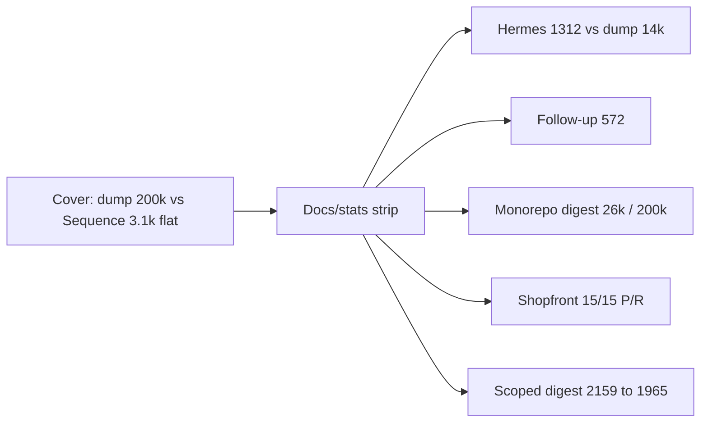

# Advertisable stats + finish-the-queue plan

**Owner quote:** Is main aligned and ready to act? What other stats can we honestly show? Prepare plans so every featured innovation has an example we can plot.

**User-seat Done when:** A human can open this file and see (1) ready-to-run status, (2) which numbers are measured vs unfinished, (3) one example + chart hook per claim, (4) the remaining queue with a finish plan that produces plottable data.

**Inverted-fix ban:** Do not invent a 200k live-accuracy %. Do not write “beats LangGraph” or “50% cheaper.” Do not put G1’s 2924 on the site as if it were the 200k-bucket run (that run was **3073**). Do not advertise thin seams (distill / refine / verify / seqd stream) as shipped product.

**Status:** 2026-08-13 · on `main` · second measured strip on site · S2 buckets **2924 flat** (cover stays **3073**). Live 200k accuracy still UNFINISHED. Tip hash lives in [`HANDOFF-AGENT-RESTART.md`](../HANDOFF-AGENT-RESTART.md) only — do not stamp SHAs here.

---

## Ready to act?

Tip and merge state: [`HANDOFF-AGENT-RESTART.md`](../HANDOFF-AGENT-RESTART.md). Site cover is **3073** (200k-bucket run); G1 scoped prompt is **2924** — different measurements (see S2). Do not copy those into a “local main = hash” row; it goes stale the next merge.

Go command:

```bash
git checkout main && git pull
pnpm -r build
pnpm app -- --no-open --port 4173 --repo "$PWD"
```

---

## Two games (do not mix on one bar)

| Game | What you may say | What you must not say |
| --- | --- | --- |
| **A — Tiny attached ask** (shopfront ~4k source) | Dump of six files can be cheaper (~1961) than Sequence’s assembled prompt (~2.9–3.1k). Sequence keeps the map. | “We are 50% cheaper on small repos.” |
| **B — Dump window fill** (50k–200k) | Dump filled 200k (73 files). Sequence shopfront ask stayed **flat 3073** at every bucket. | “Live accuracy in the last 50k is X%.” That is **UNFINISHED**. |

Site cover card is **Game B**, labeled measured shopfront. Good.

---

## Stats we can show today (measured)

Each row: **claim → example a human can replay → chart → source**. Tokenizer is `approxTokens` (chars/4) unless noted.

### Token diet (board vs dump)

| # | Claim | Example (replay) | Chart | Source | On site? |
| --- | --- | --- | --- | --- | --- |
| T1 | Dump can fill a 200k window; Sequence shopfront ask does not grow | `node tools/bench/agent-context-bench.mjs --buckets` | Line: dump 50/100/150/200k vs Sequence flat 3073 | [`agent-context-bench-200k.md`](agent-context-bench-200k.md) | **Yes** (cover card) |
| T2 | This monorepo digest stays ~13% of 200k | `buildAskPrompt("what is fragile?")` on `/workspace` | Bar: 25962 digest / 26869 prompt vs 200k | round-1 results writeup (deleted 2026-08-20) | **Yes** (second strip) |
| T3 | Empty-board design is ~10× cheaper than hunting this repo | Hermes: “Break down a Hermes agent…” | Bar: Sequence **1312** vs dump **~13–14k** | results.md | **Yes** (second strip) |
| T4 | Follow-ups do not re-dump | “Rename Prompt Optimizer to Crafting Engine” | Bar: **572** tok labels vs would-re-grep | results.md | **Yes** (second strip) |
| T5 | Named-service asks get a subgraph, not the whole 8-service digest | “Explain how orders reaches payments and postgres.” | Bar: full digest **2159** → scoped **1965**; prompt **3073 → 2924**; +file research **3739** | results.md G1/G2 section | **Yes** (second strip; cover stays 3073) |
| T6 | File research is capped, not a repo dump | Same ask after G2 | Count: **6** files (`payments_client.py`, `db.py`, …) of 27 | raw.json | No — footnote on T5 |

Needles that must stay on any token chart: `orders→payments` http, `orders→postgres` db, **no** gateway→redis.

### Grounded scan (edges, not tokens)

| # | Claim | Example | Chart | Source | On site? |
| --- | --- | --- | --- | --- | --- |
| E1 | Shopfront service-level edges are exact vs hand truth | `sequence score` shopfront vs `ground-truth.json` | 15/15 TP, 0 FP, 0 FN · **100% P / 100% R** | [`TRANSLATION_GRADE.md`](../TRANSLATION_GRADE.md) | **Yes** (second strip · these graphs) |
| E2 | Four public microrepos also 100% P/R at last baseline | robot-shop 16/16, online-boutique 15/15, spring-petclinic 12/12, + fourth in baseline | Grouped bars per repo | [`tools/qa-loop/baseline.json`](../../tools/qa-loop/baseline.json) | Footnote on strip (names only; not a new scan) |
| E3 | Plain-English tree drops nothing the scanner found | 11 fixtures, 100% node coverage, 0 dropped files | Table or stacked 100% bars | TRANSLATION_GRADE | No |
| E4 | Honesty: 0 invented sourceRefs on that set | 108 plain nodes, 0 honesty violations | Count badge | TRANSLATION_GRADE | No |

**Caveat (already in the grade):** edge P/R is ground-truthed on a **small set**. Cap the slogan at “on these fixtures / these four truths,” not “all codebases.”

### Product features that already have a demo, not a token number

| Feature | Example the site/app already plays | Stat to add later |
| --- | --- | --- |
| Empty-board → seqd | Demo prompt 01 Hermes | T3 (1312 tok) |
| Journey A from scratch | Demo prompt insurance | Owner walk still the claim gate |
| Attached shopfront map | Demo shopfront path | T1 + G1 |
| Ghost proposal (additive) | “Add recommendations…” — `proposal:` ids, redis trap | Recs prompt **3109**; board intact |
| Plan tasks → Task Board cards | **v1-retired** (do not advertise; web2 has no Task Board cards surface) | — |
| Mid-turn tools + Accept/Deny | `propose_files` / FileEditProposalBar | Tool-round count per ask (not measured) |
| Orthogonal elbows + Connect | Site demo + Architecture board (`6428e08`) | Visual, not a number |
| Local-first | No key, attach still works | Binary: core path works keyed-off |

---

## Stats we must not advertise yet

| Claim people want | Reality | How to finish (plottable) |
| --- | --- | --- |
| Live accuracy last 50k of 200k / toward 1M | Needle found at **50k START only**. 100/150/200k **UNFINISHED**. Overlay is RULER / NIAH / Lost-in-the-Middle | **S3** below — stuff context, score needles, publish % only if the run completes |
| “Beats LangGraph” | We compared pie-agent list/grep/read, **not** LangSmith / checkpoints / HITL | Optional LangGraph install session; until then say “dump/search class” |
| Provider billing tokens | No key in bench env; numbers are `approxTokens` | Cheap key + `/api/ask` `usage` records |
| Seqd incremental stream | Parked — provider returns **one shot**; no fake deltas ([`seqd-stream-park.md`](seqd-stream-park.md)) | Resume when SSE has real `delta` |
| Distill / refine / verify as full product | Thin seams shipped; LLM bodies / rollback / allowlisted verify **UNFINISHED** | Track B/C/D in [`harness-open-queue-tracks.md`](harness-open-queue-tracks.md) |
| Desktop download from socials | Site CTA exists; **release assets unpublished** | Owner Track G |
| “Replaces Cursor” | W5 owner Journey A/B walks **unsigned** | Owner walks, not a chart |

---

## Chart pack to add (existing numbers only)

Do **not** replace the cover 200k-vs-3.1k card. Add a **second measured strip** (docs + optional site §) so every innovation has a plot.



**Copy rules (BRAND-CHECK):** keep “not a named-product bake-off”; keep 3073 on the **cover** (bucket run 2026-08-12); second strip may cite G1 **2924** as a different run; never “50% cheaper.” Game B bars say **file-stuffing coding agent**, not “dump.” Claude Code / Cursor belong in the legend and the dated Artificial Analysis panel, not on Sequence token bars.

| Panel | Series | Y | Caption |
| --- | --- | --- | --- |
| Cover (already) | dump filled vs Sequence shopfront | tokens vs window | Measured 2026-08-12 · 3073 flat |
| Hermes | Sequence design vs dump grep this repo | tokens | Empty board; dump has no seqd |
| Follow-up | 572 vs implied re-search | tokens | Board intact |
| Monorepo | 26k vs 48k budget vs 200k | tokens | 13% of 200k; never last-50k |
| Grounded edges | 4 truth repos P/R | % | 100/100 on those truths |
| Scoped ask | full vs subgraph vs +files vs dump 6-file | tokens | Subject subgraph + file research; dump still cheaper on 6 files |

---

## Queue → finish plans (each produces a stat or an honest parked)

### S2 — Rebench 200k buckets after G1 (small, honesty)

**Why:** Cover says 3073. `buildAskPrompt` now scopes that ask to **2924**. The bucket table in `agent-context-bench-200k.md` kept the pre-G1 assembly as the cover run.

**Done when:** `node tools/bench/agent-context-bench.mjs --buckets` on tip; 200k doc + raw JSON updated; cover stays “3073 (bucket run 2026-08-12)”; second strip / 200k doc say 2924 flat. Needles unchanged. No LangGraph claim.

**Lock:** shopfront prompt at every bucket equal (flat); dump still fills 50k–200k.

**Landed 2026-08-13:** prompt **2924** at 50/100/150/200k; dump filled (74 files / 200369 tok). Recs ask now **3042** (was 3109) — also not the cover card. Needles unchanged.

### S3 — Live window accuracy (the missing cliff chart)

**Why:** Cover SVG no longer fakes a cliff %; the *accuracy* line is still unfinished.

**Done when:** same cheap model, dump window stuffed to 50/100/150/200k with START / MIDDLE / LAST50K needles; Sequence path never stuffed; publish hit/miss per bucket. If the run cannot complete, leave **UNFINISHED** — cite papers, no %.

**Lock:** a table `bucket × needle → found|miss|unread`. No invented fade toward 1M.

**Related (not S3):** named-CLI live-path on shopfront + haystack cap — [`named-harness-shopfront-game-b.md`](named-harness-shopfront-game-b.md). OpenCode `big-pickle` consumed **15–24k** input tokens (not the 50–200k fill) and scored all three needles grounded. Claude Code launched **not logged in** (`input_tokens: 0`). Cursor agent CLI missing. This does **not** close stuffed-dump last-50k accuracy.

### S4 — Grounded-scan public strip (qa-loop + grade)

**Why:** Token charts are Game B. The moat is also **edges from evidence**.

**Done when:** shopfront `score` + committed grade/baseline; site/docs may show P/R bars **labeled fixture/truth-set**, not “all GitHub.”

**Lock:** shopfront 15/15 still holds; baseline.json regressions fail CI/docs.

**Landed 2026-08-13 (copy, not a new qa:full):** strip cites shopfront **15/15** vs `ground-truth.json` and names robot-shop / online-boutique / spring-petclinic / microrealestate as committed truths. Smoke `sequence score` on shopfront this session: **15/15**, 0 FP, 0 FN. Slogan cap: “on these hand-truthed graphs.”

### Q1 — Seqd incremental stream (parked)

Blocked on provider token/delta SSE. Do not fake partial drawing. Resume conditions in [`seqd-stream-park.md`](seqd-stream-park.md). Stat when unparked: time-to-first-node on board vs time-to-full-answer.

### Q2 — Harness thin seams (B distill / C refine / D verify)

LLM skill bodies, refine+rollback UI, allowlisted verify. Each seam already has a stub. Finish = locking test + one owner-visible example (a distilled skill used on an ask; a refine Accept/Deny; a verify node that ran `pnpm test`). Stat: extra tokens of skill body vs full dump (same family as T4).

### Q3 — Public beta send (owner)

Desktop release assets **or** honest “clone + `./start.sh`” on socials; W5 Journey A/B walks. Checklist: [`HANDOFF-AGENT-RESTART.md`](../HANDOFF-AGENT-RESTART.md) W4. Not a token chart.

### Q4 — Owner-gated (do not code-fake)

ADR-011 Scratch fold · ADR-013 Phase E / LoRa · unrestricted PTY · hosted signing. [`harness-open-queue-tracks.md`](harness-open-queue-tracks.md).

---

## Suggested build order (advertising first)

1. **E1 shopfront 15/15 + E2 baseline names** — **landed** on the second strip (these graphs, not all GitHub).
2. **Chart pack from existing JSON** (T2–T5, E1) — **landed** on index + docs; cover 3073 untouched.
3. **S2 bucket rebench** — **landed**; cover stays 3073; strip/doc cite 2924 flat.
4. **S3** only with budget for a live stuffed-context run (paste-ready below).
5. **Q2/Q1** when you want product depth, not homepage numbers.
6. **Q3** when you want people to install.

---

## File map

| Path | Role |
| --- | --- |
| [`agent-context-bench-200k.md`](agent-context-bench-200k.md) | Bucket table (cover 3073; post-G1 flat 2924) |
| [`TRANSLATION_GRADE.md`](../TRANSLATION_GRADE.md) | 15/15 + labeling |
| [`tools/qa-loop/baseline.json`](../../tools/qa-loop/baseline.json) | Real-repo P/R |
| [`named-harness-shopfront-game-b.md`](named-harness-shopfront-game-b.md) | Named CLI Game B (OpenCode live-path; Claude not logged in) |
| [`harness-open-queue-tracks.md`](harness-open-queue-tracks.md) | B–H tracks |
| [`seqd-stream-park.md`](seqd-stream-park.md) | Stream parked |

---

## Paste-ready S3 — live 200k needle accuracy (parked; do not fake)

**Owner quote:** Measure live dump needle hit/miss at 50/100/150/200k (START / MIDDLE / LAST50K). Sequence path is never stuffed.

**User-seat Done when:** A human opens `docs/research/agent-context-bench-200k.md` and sees a table `bucket × needle → found | miss | unread` from a cheap-model run. Cover 3073 and strip 2924 stay token charts. If the run cannot complete, the accuracy line stays **UNFINISHED** and still cites RULER / NIAH / Lost-in-the-Middle — no invented %.

**Inverted-fix ban:** Do not publish a fade-toward-1M percentage. Do not swap cover 3073 for 2924. Do not name LangGraph. Do not commit haystack bodies.

**Go (dedicated session, cheap model, same both paths):**

```bash
pnpm --filter @sequence/analyzer build
node tools/bench/agent-context-bench.mjs --buckets
# Then stuff dump windows to 50/100/150/200k with planted needles.
# Sequence path: shopfront ask prompt only (2924 post-G1; cover run was 3073).
# Ask the three shopfront needles at START / MIDDLE / LAST50K.
# Commit only the hit/miss table + method. $0 slogans.
```

Needles: orders→payments http, orders→postgres db, **no** gateway→redis.

---

## S5 — Named-harness shopfront Game B (PARTIAL · #82/#85 on main)

**Owner quote:** Be clear: it’s versus Claude Code. Named brands. Same test if possible.

**Landed:** [`named-harness-shopfront-game-b.md`](named-harness-shopfront-game-b.md) — OpenCode live-path needles grounded; Cursor cloud session **1281 tok**. Claude Code launched **not logged in**. Stuffed 50–200k dump accuracy still **UNFINISHED**. Site still must not put those product names on Sequence token bars until Max says.

**User-seat Done when:** that file exists with date, model, harness version, and raw token counts. OpenCode + Cursor session are on `main`. Remaining: Claude Code logged-in run; stuffed last-50k %.

**Inverted-fix ban:** Do not substitute our pie-agent file-stuffing harness and label it Claude Code. Do not mix Artificial Analysis Coding Agent Index scores onto the 3073 token axis. AA is DeepSWE + Terminal-Bench v2 + SWE-Atlas-QnA — not shopfront Game B.

**Paste this into the benchmarker agent:**

```
Replay packages/analyzer/test/fixtures/shopfront Game B (live-path +
typed-edge needles) against a NAMED coding agent, not our file-dump
harness.

Needles (must match docs/research/agent-context-bench-200k.md):
- orders → payments  http  (present)
- orders → postgres  db    (present)
- gateway → redis    MUST NOT be claimed

Buckets: 50k, 100k, 150k, 200k. Report input tokens the agent actually
consumed, not the cap. Score grounded / hallucinated / missed.

Named targets, in order, if the harness can launch them:
1. Claude Code CLI (claude) on the shopfront tree
2. Cursor agent CLI if available
3. OpenCode if available

Do not substitute our pie-agent dump and label it Claude Code.
Write results to docs/research/named-harness-shopfront-game-b.md
with date, model, harness version, and raw token counts.

Until those files exist, the site must not put those product names
on the Sequence token bars.
```

**Remaining:** Claude Code logged-in; stuffed last-50k % (S3). Q1 seqd stream stays parked until SSE has a real `delta` ([`seqd-stream-park.md`](seqd-stream-park.md)). Q2 distill/refine/verify stay thin seams. Q3–Q4 are owner gates (desktop socials, W5 walks, ADR-011, LoRa, PTY).

### S6 — AA-comparable Sequence run (UNFINISHED · paste into the bench agent)

See [`aa-comparable-bench-plan.md`](aa-comparable-bench-plan.md). Do not plot Sequence on the Artificial Analysis 2×2 until that run exists. Until then the site advertises **Hermes / Aegis / Hyperform** (our tests vs file-stuffing).


