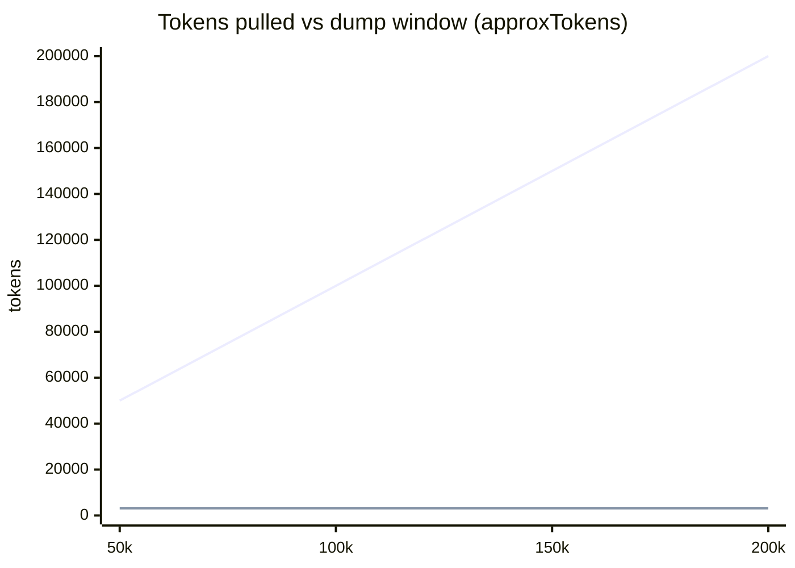
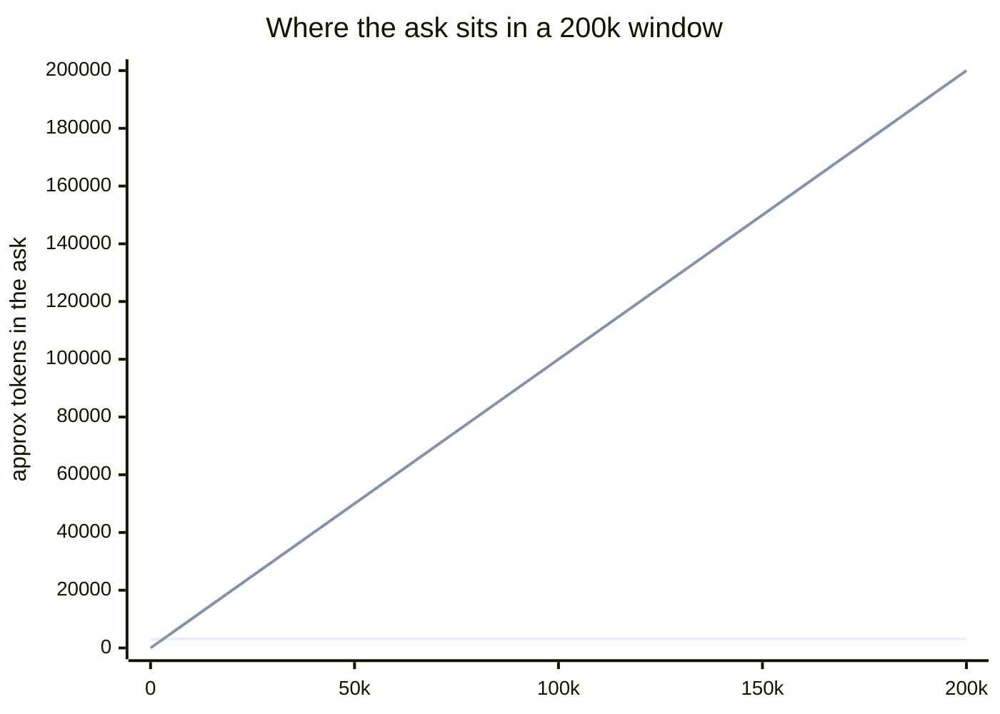

# Agent context bench — 200k window

**Owner quote:** Get as close as you can to 200k. Add a huge shopping service on shopfront. Monitor efficiency every 50k. Do not publish charts of other agents. Use existing long-context papers plus our own pull numbers.

**Status:** dump window **filled to 200k** (static). Cover card stays **3073** (bucket run 2026-08-12). After subject-subgraph (G1), the same shopfront ask is **2924** and still **flat** at every bucket — a different run, not a cover rewrite. Live needle at 50k START only. Live accuracy at 100k / 150k / 200k **UNFINISHED** — overlay cited public papers, no invented %.

**Measured:** cover table 2026-08-12; S2 rebench 2026-08-13. Harness: `node tools/bench/agent-context-bench.mjs --buckets`. Raw: [`agent-context-bench-200k-raw.json`](agent-context-bench-200k-raw.json) (now the 2924-flat run). The older round-1 writeups (`agent-context-bench-results.md`, `agent-context-bench-comparison.md`) were deleted 2026-08-20; git history has them.

Canonical shopfront fixture was **not** mutated.

---

## Method

| Item | Value |
| --- | --- |
| Sequence path | Shopfront `buildAskPrompt` only. Prompt is **re-measured at every bucket, not grown**. Additive ask uses the same digest; new nodes are a proposal, not scanned evidence. |
| Dump path | Accumulate this repo’s source (skip `node_modules` / `dist` / `.git` / …) until `approxTokens` crosses 50k / 100k / 150k / 200k. Pie-agent class: list → grep → read. |
| Needles | Shopfront `routes.py`, `payments_client.py`, `db.py`, `ground-truth.json` planted at **START (0)**, **MIDDLE (~99.6k)**, **LAST50K (~146k)**. |
| Live model | Cheap session model, same both paths. No OpenRouter. No provider key. **$0** billed. |
| Published names | **None.** Charts say “ungrounded dump” vs “Sequence board + digest.” |

Tokenizer: `approxTokens` (chars/4), same as the analyzer. Not BPE.

---

## Tokens pulled vs window

Sequence does not ride the dump window. Dump does.

**Cover / bucket run 2026-08-12** (site compare-card — do not replace with G1):

| Window | Dump tokens in window | Dump files | Sequence shopfront prompt | Sequence recs prompt | Sequence digest |
| --- | --- | --- | --- | --- | --- |
| 50k | **50 000** (filled) | 17 | **3073** | **3109** | **2159** |
| 100k | **100 000** (filled) | 38 | 3073 | 3109 | 2159 |
| 150k | **150 000** (filled) | 55 | 3073 | 3109 | 2159 |
| 200k | **200 000** (filled) | 73 | 3073 | 3109 | 2159 |

Dump reached **202 311** tok from **73** files (1590 source files available).

**S2 rebench 2026-08-13** (after `scopeDigestToAsk` in `buildAskPrompt`). Same ask, still flat, **not** the cover number:

| Window | Dump tokens in window | Dump files | Sequence shopfront prompt | Sequence recs prompt | Sequence digest |
| --- | --- | --- | --- | --- | --- |
| 50k | **50 000** (filled) | 17 | **2924** | **3042** | **2159** |
| 100k | **100 000** (filled) | 38 | 2924 | 3042 | 2159 |
| 150k | **150 000** (filled) | 55 | 2924 | 3042 | 2159 |
| 200k | **200 000** (filled) | 74 | 2924 | 3042 | 2159 |

Dump reached **200 369** tok from **74** files (1607 source files available). Shopfront prompt equal at every bucket (flat). Needles in window:

| Window | START (0) | MIDDLE (~99.6k) | LAST50K (~146k) |
| --- | --- | --- | --- |
| 50k | y | n | n |
| 100k | y | y | n |
| 150k | y | y | y |
| 200k | y | y | y |



Upper line: ungrounded dump (accumulated source). Lower line: Sequence shopfront ask prompt on the **cover run** (flat **3073**). After subject-subgraph the same ask is **2924** and still flat — second strip / this doc, not the cover card. Monorepo Sequence digest (~26k) still sits well below the last 50k of a 200k window.

This is **not** the site’s old cartoon 50–60k vs 25–30k. Cover shopfront Sequence is **3073**; dump *can* fill the whole 200k if it keeps file bodies.

---

## Shopfront long task: add recommendations

**Ask:** Add a recommendations service: it reads order history from postgres, is called from `orders` after `insert_order`, and gateway exposes `GET /recommendations`. Do not invent a redis edge from gateway.

Why this service: shopfront already has orders, payments, inventory, shipping, invoices — no recs. Missing node, not a random microservice.

| path | tokens_in | tokens_tool | answer_ok | board_intact | $ |
| --- | --- | --- | --- | --- | --- |
| sequence-board (recs) | 3109 (cover-era) / **3042** after G1 | 0 (file research skipped) | y — `proposal:recommendations`; reused `svc:orders`, `svc:gateway`, `ds:postgres` | y | 0 |
| dump-search (recs) | shopfront list/grep/read (5 files + **38-file list in chat**) | 5 reads | y — recs does not exist; no gateway→redis | n/a (no board; bibliography) | 0 |
| sequence-board (follow-up wire) | outline-sized (node labels only) | 0 | y — same ids, recs still proposal | y | 0 |

Needles:

- Sequence did **not** present recommendations as scanned (`recommendations_as_scanned: false`).
- Neither path invented gateway→redis (compose trap in [`ground-truth.json`](../../packages/analyzer/test/fixtures/shopfront/ground-truth.json)).
- Dump listed the fixture in chat (`dumped_file_list_into_chat: true`). Sequence pointed at board ids.
- Follow-up Sequence did **not** re-dump files (`re_dumped_files: false`).

`wantsAskFileResearch` is **false** for this wording — same product fact as round 1’s topology ask. Sequence still had the digest; dump still hunted files.

---

## Needle accuracy vs window

| Window | Live dump needle check | orders→payments | orders→postgres | gateway uses redis? | recs as scanned? |
| --- | --- | --- | --- | --- | --- |
| 50k (needle at START) | ran; haystack ~56k tok file; **not fully read** (sampled + search) | y | y | n (correct) | n (correct) |
| 100k (MIDDLE planted) | **UNFINISHED** — did not stuff ~100k into the live model | — | — | — | — |
| 150k (LAST50K planted) | **UNFINISHED** | — | — | — | — |
| 200k | **UNFINISHED** | — | — | — | — |

50k success is the **easy** NIAH position (needle at the start). It does **not** prove a last-50k cliff. We did not pad junk to fake one.

### Public overlay (ungrounded dump class — no named products)

Cite, do not invent a Sequence-vs-X percentage:

- **RULER** (Hsieh et al., NVIDIA, 2024) — [arxiv:2404.06654](https://arxiv.org/abs/2404.06654). Vanilla needle-in-a-haystack can stay high while multi-hop / aggregation tasks degrade as length grows. Advertised context ≫ effective context for many models. Yi-34B (claimed 200k) is discussed as degrading as input length and task complexity rise.
- **NIAH** (Kamradt, 2023) — retrieval vs depth; often U-shaped (strong at start/end, weak in the middle).
- **Lost in the Middle** (Liu et al., 2024) — [arxiv:2307.03172](https://arxiv.org/abs/2307.03172). Accuracy drops when the fact sits in the middle of a long context.

How this maps to our chart without a live 200k run: Sequence’s shopfront ask **never enters** the last 50k of a 200k window (~3k tok). Dump *can* sit there (our LAST50K plant is at ~146k). Whether a given dump model cliffs is a **published long-context pattern**, not a number we measured past 50k START.



---

## Workflow efficiency

Turn 1 (explain / add recs) vs turn 2 (wire recs on the same board):

| Turn | Sequence | Dump |
| --- | --- | --- |
| 1 | ~3.1k digest+directives; seqd proposal | list 38 files + 5 reads; plan in prose |
| 2 | node labels + proposal id; no file dump | would re-list / re-grep (not re-run live) |

The board stayed the map: `svc:orders`, `svc:payments`, `ds:postgres` still pointable; `proposal:recommendations` is a ghost.

---

## UNFINISHED

- **Live dump accuracy at 100k / 150k / 200k** — context not stuffed. Cliff line = RULER / NIAH / Lost-in-the-Middle citations, not our %. Named-CLI live-path (OpenCode, not dump-stuffed) is a different run: [`named-harness-shopfront-game-b.md`](named-harness-shopfront-game-b.md).
- **Live needle at MIDDLE or LAST50K** — 50k check was START only.
- **Provider-reported usage** — no key; tokens are `approxTokens`.
- **Site bars** — cover is measured **3073** (bucket run 2026-08-12). Second strip cites G1 **2924** as a different run. Live 200k accuracy % still UNFINISHED. Do not write “50% cheaper” into `site/`.

---

## How to re-run

```bash
pnpm --filter @sequence/schema --filter @sequence/export --filter @sequence/acp --filter @sequence/analyzer build
node tools/bench/agent-context-bench.mjs --buckets
```

Not wired into `pnpm test`. Does not write haystack bodies into git.
