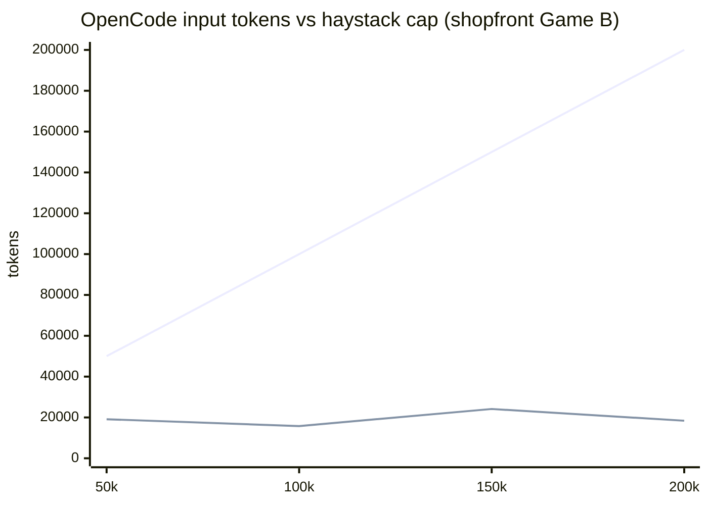

# Named harness — shopfront Game B

**Owner quote:** Replay shopfront Game B (live-path + typed-edge needles) against a named coding agent, not our file-dump harness.

**User-seat Done when:** This file names the harness, model, date, and **raw input tokens the agent actually consumed** (not the 50/100/150/200k cap), plus grounded / hallucinated / missed on the three needles from [`agent-context-bench-200k.md`](agent-context-bench-200k.md).

**Inverted-fix ban:** Do not run `tools/bench/agent-context-bench.mjs` dump-search and label it Claude Code. Do not invent a last-50k accuracy %. Do not claim “beats LangGraph.”

**Status:** 2026-08-13. Harness `1.0.0`. Named CLIs: Claude Code launched **not logged in**; Cursor **agent CLI** missing. OpenCode scored the haystack buckets. **This Cursor cloud session** then live-pathed shopfront itself (no extra API key) and scored the same three needles.

Tokenizer for haystack fill / Cursor file pull: `approxTokens` (chars/4). OpenCode numbers are that CLI’s `usage.input`. Cursor-session numbers are **files this agent actually opened**, not a Cursor billing meter (this pod does not expose `usage.input`).

---

## Auth — what needs a key, what does not

| Thing | Already logged in here? | Extra key? |
| --- | --- | --- |
| **This Cursor cloud agent** | Yes. Run `bc-fb6c45ad-1731-4a86-adef-10d4f934a5b6`, model `cursor-grok-4.6-high`. `CURSOR_AGENT` is set. | **No.** Do not paste a Cursor API key into the pod. |
| **Cursor agent CLI** (`agent -p` / `cursor-agent`) | No. Binary not on PATH. | Would need `CURSOR_API_KEY`. Different launch path from this cloud session. |
| **Claude Code CLI** | No. Binary runs, then: “Not logged in · Please run /login”. | Anthropic `/login` or `ANTHROPIC_API_KEY`. Cursor login does **not** log you into Claude Code. |
| **OpenCode** `opencode/big-pickle` | Yes (free provider on this VM). | None for that model. |

Do not treat “I am in Cursor” as “Claude Code is authenticated.”

---

## Launch table

| Target | Binary | Version | Launch | Auth / tokens |
| --- | --- | --- | --- | --- |
| Claude Code CLI | npx @anthropic-ai/claude-code | 2.1.231 (Claude Code) | launched | not logged in · `input_tokens: 0` · "Not logged in · Please run /login" |
| Cursor agent CLI | missing | — | not launched | `CURSOR_API_KEY` unset; `cursor-agent` / `agent` not on PATH |
| **This Cursor cloud session** | Cursor cloud agent | `cursor-grok-4.6-high` | ran live-path | no extra key · **1281** approxTokens of files opened |
| OpenCode | npx opencode-ai | 1.18.18 | launched | model `opencode/big-pickle` · provider `opencode` · $0 on probe |

Claude Code JSON (truncated): `api_error` / “Not logged in · Please run /login”. That is a **named** binary, not pie-agent.

---

## Needles

Same as the 200k doc:

| Needle | Truth |
| --- | --- |
| orders → payments | **present**, kind **http** (`orders/app/payments_client.py` → `PAYMENTS_URL`) |
| orders → postgres | **present**, kind **db** (`orders/app/db.py` → `DATABASE_URL`) |
| gateway → redis | **must not be claimed** (compose `depends_on` trap; gateway source has no redis) |

Score: **grounded** (correct present/absent + kind) · **hallucinated** (wrong claim or wrong kind) · **missed** (required edge not asserted) · **unread** (agent said unread / no parseable JSON).

---

## This Cursor session (live-path, 2026-08-13)

Internal list → grep → read on `packages/analyzer/test/fixtures/shopfront`. Did **not** stuff a 50k–200k haystack. Did **not** read `ground-truth.json` for the score (source only).

JSON:

```json
{
  "orders_payments": {"present": true, "kind": "http", "evidence": "orders/app/payments_client.py httpx POST {PAYMENTS_URL}/charge; routes.py awaits charge_order"},
  "orders_postgres": {"present": true, "kind": "db", "evidence": "orders/app/db.py sqlalchemy create_engine(DATABASE_URL); compose postgres://…@postgres"},
  "gateway_redis": {"present": false, "kind": null, "evidence": "grep gateway/ for redis: no matches; compose depends_on redis is a trap. orders/app/events.py does use redis — that is orders, not gateway"}
}
```

| Needle | Score |
| --- | --- |
| orders → payments http | **grounded** |
| orders → postgres db | **grounded** |
| gateway → redis | **grounded** (correctly not claimed) |

Files opened (approxTokens chars/4): compose 394 · `payments_client.py` 82 · `db.py` 170 · `events.py` 46 · `routes.py` 165 · `gateway/index.ts` 145 · `http.ts` 163 · `routes/orders.ts` 116 · **total 1281**.

That 1281 is file bodies this agent pulled. It is **not** Cursor billed input (unknown here) and **not** the 200k cap. OpenCode on the same needles pulled **15–24k** billed input (system + project dump). Sequence shopfront prompt stays **3073 / 2924** — different harness.

---

## Buckets (OpenCode live-path)

Workdir = copy of shopfront + `haystack/` filled to the bucket with planted START / MIDDLE / LAST50K needles. Prompt asks for JSON edges. Haystack bodies are **not** in git.

| Window | Run | Haystack fill (approxTokens) | Input tokens (agent) | orders→payments http | orders→postgres db | gateway→redis |
| --- | --- | --- | --- | --- | --- | --- |
| 50k | ok | 50333 | 19129 | grounded | grounded | grounded |
| 100k | ok | 104221 | 15784 | grounded | grounded | grounded |
| 150k | ok | 152340 | 24144 | grounded | grounded | grounded |
| 200k | ok | 200369 | 18400 | grounded | grounded | grounded |

Haystack fill is the cap we planted. **Input tokens** are OpenCode `step_finish.tokens.input` — the agent did **not** ingest the 200k fill. Sequence shopfront Game B (different harness) stays flat **3073** cover / **2924** after subgraph — see the 200k doc. That is **not** an OpenCode number.



Upper line: haystack fill cap. Lower line: tokens OpenCode actually billed as input. Do not read this as a Sequence-vs-OpenCode bake-off.

---

## What we did not do

- Did not substitute pie-agent list→grep→read and call it Claude Code.
- Did not score Claude Code buckets after login failed (`input_tokens: 0` is the measured usage, not a needle table).
- Did not spawn Cursor agent CLI (binary + key missing). This section **is** the cloud session live-path, labeled as such — not `cursor-agent -p`.
- Did not write “50% cheaper” or a live 1M fade.

Raw JSON: [`named-harness-shopfront-game-b-raw.json`](named-harness-shopfront-game-b-raw.json).

---

## How to finish Claude Code / Cursor CLI

See `tools/bench/named-harness-shopfront-game-b.mjs`. Claude Code still needs Anthropic `/login` or `ANTHROPIC_API_KEY`. The **Cursor CLI** still needs `CURSOR_API_KEY` + `agent -p`. This cloud session already scored the needles without those.
