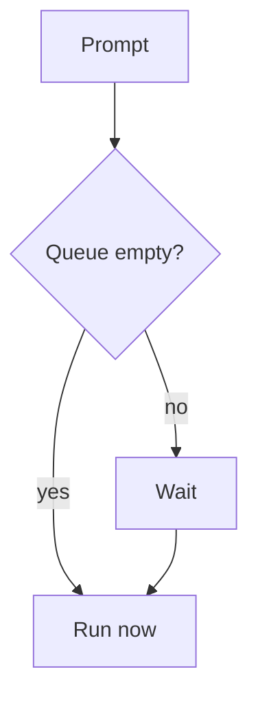
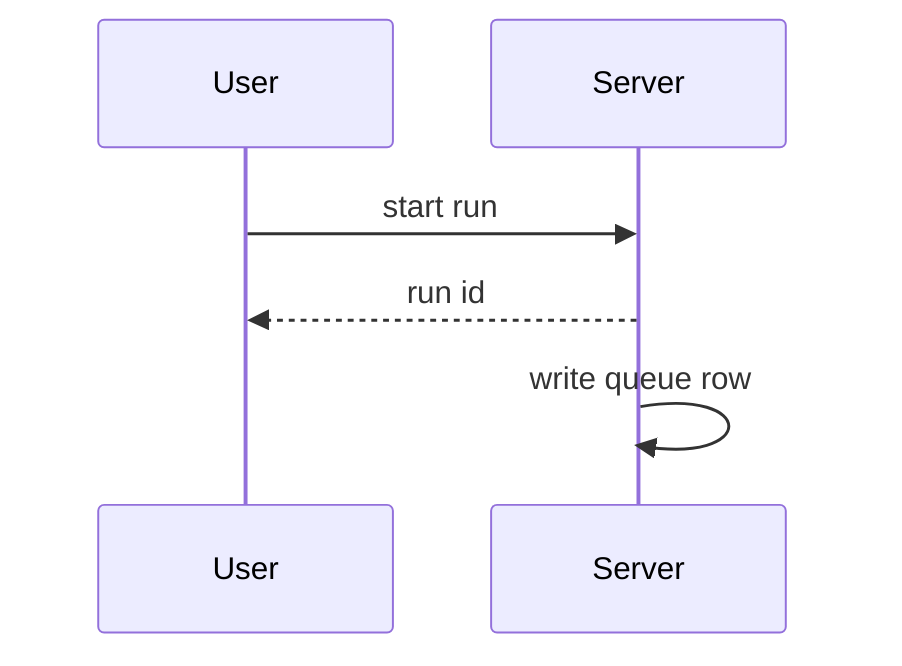

# 0007: Use a local queue for agent runs

## Status

Accepted

## Context and Problem Statement

Agent runs must survive a restart. We need a queue that works with no network.

## Decision Drivers

* Local-first
* Honest errors

## Considered Options

| Option | Offline | Cost |
|---|---|---|
| SQLite queue | yes | low |
| Hosted queue | no | high |

## Decision Outcome

Chosen option: "SQLite queue", because it works offline.

### Consequences

* Good, because runs survive restarts
* Bad, because one writer at a time

## Flow



## Handshake



## Code

```ts
const x: number = 1;
```
